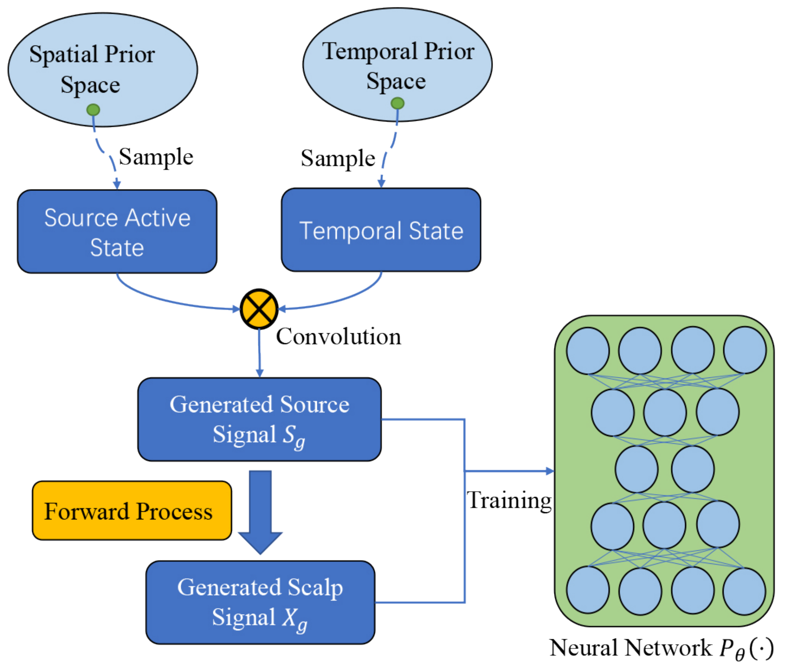
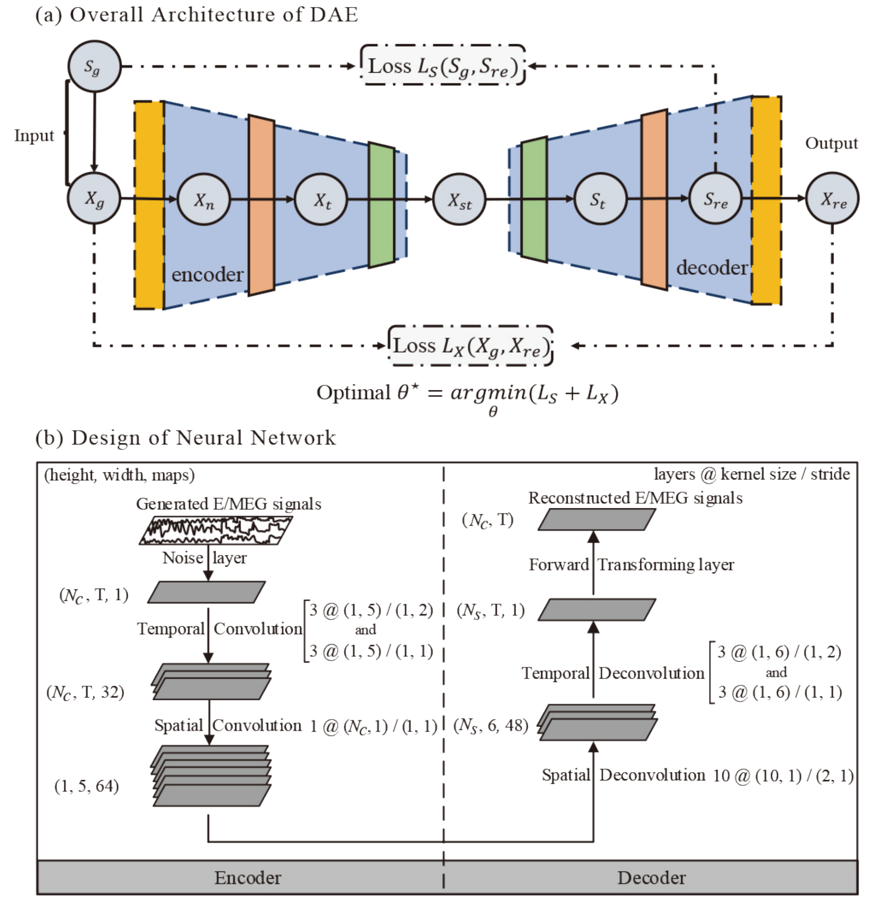

<h1 align="center">DST-CedNet</h1>

<p align="center"><strong>Electromagnetic Source Imaging via a Data-Synthesis-Based Convolutional Encoder–Decoder Network</strong></p>

<p align="center">Gexin Huang · Ke Liu · Jiawen Liang · Chang Cai · Zheng Hui Gu · Feifei Qi · Yuanqing Li · Zhu Liang Yu · Wei Wu</p>

<p align="center"><em>IEEE Transactions on Neural Networks and Learning Systems, 35(5), 6423–6437, 2024</em></p>

<p align="center">
  <a href="https://doi.org/10.1109/TNNLS.2022.3209925"></a>
  <a href="#citation"></a>
  <a href="docs/MATLAB.md"></a>
  <a href="https://github.com/gexinh/DST-CedNet/actions/workflows/ci.yml"></a>
</p>

DST-CedNet learns to reconstruct cortical source time courses from EEG/MEG measurements using synthesized training data. Spatial activation patterns and temporal basis functions generate source signals; a lead field maps them to sensor measurements. A spatiotemporal convolutional encoder–decoder is trained with both source reconstruction and forward-projected sensor reconstruction objectives.

<p align="center"><a href="assets/Fig1.pdf"></a></p>

*Data synthesis and training overview. [Original figure PDF](assets/Fig1.pdf).*

## Installation

Use **Python 3.10 or 3.11** and TensorFlow 2.15. MATLAB Engine is used for data synthesis and the MATLAB comparison methods.

```bash
git clone https://github.com/gexinh/DST-CedNet.git
cd DST-CedNet
python -m venv .venv
source .venv/bin/activate
python -m pip install -e '.[train]'
```

For a CPU-only installation, use `.[cpu]` instead of `.[train]`. GPU execution additionally requires the CUDA/cuDNN versions supported by your [TensorFlow installation](https://www.tensorflow.org/install/pip).

Install the Engine package matching your MATLAB release. For **MATLAB R2023b**:

```bash
python -m pip install matlabengine==23.2.3
```

See the [MATLAB guide](docs/MATLAB.md) for other releases and temporal basis extraction.

## Quick start

Generate training data from the supplied cortical geometry, lead field, and temporal basis functions. The example uses 1024 sources, 63 sensors, and 40 time points. See the [data guide](docs/DATA.md) to use another head model.

First run a small workflow:

```bash
# MATLAB Engine: generate independent train/validation/test splits.
python scripts/synthesize.py --config configs/smoke.yaml

# Python: one epoch and one training batch.
python scripts/train.py --config configs/smoke.yaml

# Predict from the stored test observations.
python scripts/predict.py \
  --weights outputs/smoke_training/best.weights.h5 \
  --manifest outputs/smoke_synthetic/manifest.json \
  --output outputs/smoke_prediction.npz

python scripts/evaluate.py \
  --data outputs/smoke_synthetic/manifest.json \
  --prediction outputs/smoke_prediction.npz \
  --output outputs/smoke_evaluation
```

The quick start uses four examples per split and one training batch. To train with 27,000 training examples, 27,000 validation examples, and 250 epochs:

```bash
python scripts/synthesize.py --config configs/paper.yaml
python scripts/train.py --config configs/paper.yaml
```

Use [configs/paper_two_sources.yaml](configs/paper_two_sources.yaml) for two-source training. See the [model guide](docs/MODEL.md) for the architecture and objective.

## Evaluation

Compare source-imaging methods on the same synthesized observations. The evaluation includes sensor SNR, source extent, paired source extents, and temporal correlation experiments.

| Method | Command name | Runtime | Reference |
|---|---|---|---|
| Minimum-norm estimation (MNE) | `mne` | Python | [Hämäläinen & Ilmoniemi, 1994](https://doi.org/10.1007/BF02512476) |
| Weighted MNE (wMNE) | `wmne`, `wmne-matlab` | Python / MATLAB | [Dale & Sereno, 1993](https://doi.org/10.1162/jocn.1993.5.2.162) |
| LORETA | `loreta` | MATLAB | [Pascual-Marqui et al., 1994](https://doi.org/10.1016/0167-8760%2884%2990014-X) |
| Sparse Bayesian learning (SBL) | `sbl` | MATLAB | [Wipf & Rao, 2004](https://doi.org/10.1109/TSP.2004.831016), [Wipf & Nagarajan, 2009](https://doi.org/10.1016/j.neuroimage.2008.02.059) |
| FOCUSS | `focuss` | MATLAB | [Gorodnitsky et al., 1995](https://doi.org/10.1016/0013-4694%2895%2900107-A) |
| STTONNICA | `sttonnica` | MATLAB + STTONNICA package | [Valdés-Sosa et al., 2009](https://doi.org/10.1002/hbm.20784) |

For a small comparison:

```bash
python scripts/run_experiments.py --run --generate \
  --synthesis-config configs/synthesis.yaml \
  --condition snr_-5 --samples 2 \
  --methods wmne-matlab loreta sbl focuss \
  --output outputs/comparison
```

Method parameters are in [configs/baselines.yaml](configs/baselines.yaml). Results contain source estimates, per-trial metrics, and mean/SEM summaries for each method. STTONNICA uses its author's MATLAB package via `--sttonnica-dir`; see [setup and references](docs/REFERENCES.md). The [evaluation guide](docs/EXPERIMENTS.md) covers DST-CedNet comparisons, all 16 conditions, training-size experiments, and metric definitions.

<details>
<summary>Network architecture figure</summary>

<p align="center"><a href="assets/Fig2.pdf"></a></p>

[Original figure PDF](assets/Fig2.pdf).

</details>

## Citation

```bibtex
@article{huang2024dstcednet,
  author  = {Huang, Gexin and Liu, Ke and Liang, Jiawen and Cai, Chang and Gu, Zheng Hui and Qi, Feifei and Li, Yuanqing and Yu, Zhu Liang and Wu, Wei},
  title   = {Electromagnetic Source Imaging via a Data-Synthesis-Based Convolutional Encoder--Decoder Network},
  journal = {IEEE Transactions on Neural Networks and Learning Systems},
  volume  = {35},
  number  = {5},
  pages   = {6423--6437},
  year    = {2024},
  doi     = {10.1109/TNNLS.2022.3209925}
}
```

## License and sources

Original implementation code is provided under the [MIT License](LICENSE). Paper figures, modeling assets, and external software have separate sources and terms; see [source attribution](docs/THIRD_PARTY.md).
